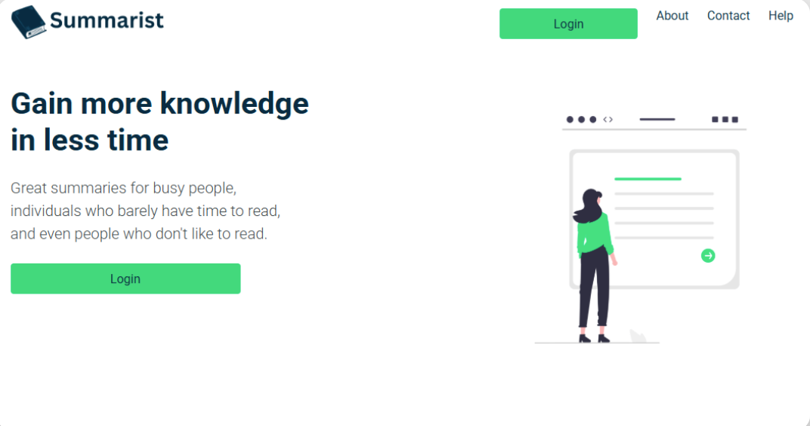

# Summarist

A book-summary app where you can browse titles, read a summary and listen to the audio version. Built in Next.js with Firebase sign-in for the Frontend Simplified program.

**Live:** https://summarist-tau-one.vercel.app

## Features

- Sign up or log in with email, Google or a one-click guest account
- "For You" page with selected, recommended and suggested books
- Search books from any page
- Book pages with a summary, tags and key details
- Audio player for each summary
- My Library page for saved books
- Choose-plan page with monthly and yearly options (payment is not connected)

## Built with

Next.js 16 (App Router) · TypeScript · Tailwind CSS v4 · Redux Toolkit · Firebase Auth and Firestore · Vercel

## Getting started

Requires Node 20.9 or newer (run `node -v` to check).

    git clone https://github.com/robertandersonux/summarist.git
    cd summarist
    npm install
    npm run dev

Then open http://localhost:3000.
